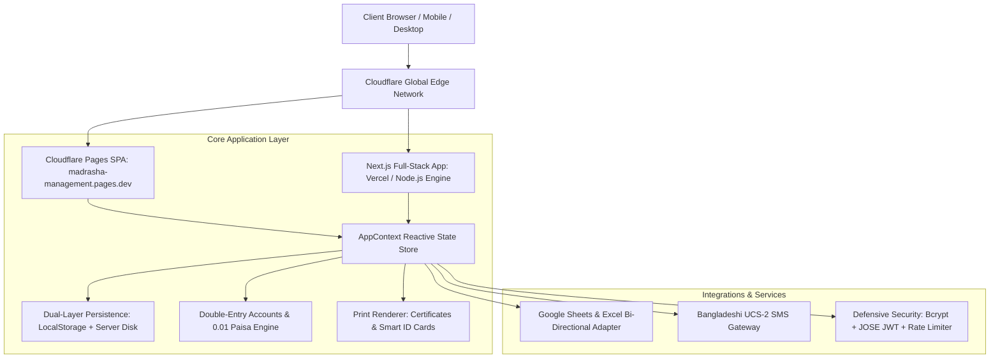

# Madrasa Management System (মাদ্রাসা ম্যানেজমেন্ট সফটওয়্যার)

[](https://madrasha-management.pages.dev)
[](https://madrasha-management-app-new-version.vercel.app)
[](scripts/verify.js)
[](docs/modules/12-security-auth.md)
[](https://nextjs.org)
[](https://vitejs.dev)
[](https://react.dev)
[](https://tailwindcss.com)
[](LICENSE)

A modern, enterprise-grade, offline-resilient **Madrasa Management & Accounting Platform** built with **React 19**, **Next.js 16 (Turbopack)**, **Vite 6**, and **Tailwind CSS**. Designed specifically for Bangladeshi madrasas to manage student admissions, 12-month tuition collection, residential mess/bazar accounting, teachers payroll, double-entry financial ledgers, SMS broadcasts, dual-sided smart ID cards, and academic testimonials.

---

## 🌐 Live Deployments

| Platform | Production URL | Description |
| :--- | :--- | :--- |
| **Cloudflare Pages** | **[https://madrasha-management.pages.dev](https://madrasha-management.pages.dev)** | Global Edge deployment (275+ cities, sub-50ms TTFB) |
| **Vercel** | **[https://madrasha-management-app-new-version.vercel.app](https://madrasha-management-app-new-version.vercel.app)** | Full-stack serverless deployment |

> **Default Demo Login:**  
> **Username:** `admin@gmail.com`  
> **Password:** `admin1234`

---

## 🏛 System Architecture



---

## ✨ Core Modules & Capabilities

| Module | Category | Live Features | Documentation |
| :--- | :--- | :--- | :--- |
| **01. Academic & Jamat** | Academics | 5 Core Jamats (হিফজ, নাজেরা, মক্তব, কিতাব, ইবতিদাইয়্যাহ), seat capacity quotas | [`01-academic-jamat.md`](docs/modules/01-academic-jamat.md) |
| **02. Student Lifecycle** | Students | 197 student directory, 12-month payment matrix, blood groups, guardian contacts | [`02-student-lifecycle.md`](docs/modules/02-student-lifecycle.md) |
| **03. Teacher & Staff** | Human Resources | Faculty profiles, designations, monthly salary sheet, daily salary advances | [`03-teacher-staff.md`](docs/modules/03-teacher-staff.md) |
| **04. Attendance System** | Operations | Student & Teacher daily attendance, 4 radio states (Present, Absent, Leave, Late) | [`04-attendance-system.md`](docs/modules/04-attendance-system.md) |
| **05. Accounts & Ledger** | Financials | 21 Deposit & 34 Expense categories, Cash/bKash accounts, Transfer rollback, Balancesheet | [`05-accounts-finance.md`](docs/modules/05-accounts-finance.md) |
| **06. Bazar & Mess** | Residential | Daily itemized bazar entries, monthly dining cost per meal, Khuraki surplus balance | [`06-bazar-mess-management.md`](docs/modules/06-bazar-mess-management.md) |
| **07. Donors & Zakat** | Charity | General donation, Zakat, Fitra, Qurbani animal hide sales, lifetime member funds | [`07-donors-zakat-fund.md`](docs/modules/07-donors-zakat-fund.md) |
| **08. SMS Gateway** | Broadcast | GSM-7 & Bengali UCS-2 counter formula, parent batch alerts, fee reminders | [`08-sms-gateway.md`](docs/modules/08-sms-gateway.md) |
| **09. Smart ID Cards** | Identification | Dual-side CR-80 card generator, high-definition photo frame, QR verification | [`09-id-card-generator.md`](docs/modules/09-id-card-generator.md) |
| **10. Certificates** | Academic | Authentic academic certificate & Prottoyon Potro with tripartite signature blocks | [`10-certificates-testimonials.md`](docs/modules/10-certificates-testimonials.md) |
| **11. Reports Engine** | Analytics | 14 dedicated financial, academic, and administrative audit reports | [`11-reports-analytics.md`](docs/modules/11-reports-analytics.md) |
| **12. Defensive Security** | Security | Bcrypt password hashing, stateless JOSE JWT, sliding rate limiter, Anti-XSS | [`12-security-auth.md`](docs/modules/12-security-auth.md) |

---

## 📊 Google Sheets & Excel Integration

The platform provides bi-directional data synchronization with Google Sheets and Microsoft Excel:
- **Bulk Student Import**: Upload `.csv` or `.xlsx` files to import hundreds of students into their respective Jamats with one click.
- **One-Click Export**: Export fee matrices, daily cash books, donor contributions, and attendance registers directly into Google Sheets.
- **Automated Webhook Sync**: Continuous synchronization via Google Apps Script.

👉 Read the full setup guide: **[`docs/GOOGLE_SHEETS_INTEGRATION.md`](docs/GOOGLE_SHEETS_INTEGRATION.md)**

---

## 📂 Repository Directory Layout

```
madrasha-management-app/
├── docs/                               # Architecture & Detailed Module Specs
│   ├── ARCHITECTURE.md                 # System Architecture & Technical Specifications
│   ├── GOOGLE_SHEETS_INTEGRATION.md    # Google Sheets Import/Export & Webhooks
│   ├── DEPLOYMENT_CLOUDFLARE.md        # Cloudflare Pages / Workers Guide
│   ├── DEPLOYMENT_VERCEL.md            # Vercel Production Guide
│   ├── API_REFERENCE.md                # REST API Documentation
│   └── modules/                        # 12 Detailed Module Documentation Files
├── src/                                # Application Source Code
│   ├── app/                            # Next.js App Router & REST API Routes
│   ├── components/                     # Domain-driven Component Architecture
│   │   ├── auth/                       # Authentic 1:1 Login & Registration Face
│   │   ├── dashboard/                  # KPI Overview & Quick Action Cards
│   │   ├── student/                    # Student Admissions, Fee Matrix, Certificates
│   │   ├── teacher/                    # Faculty Management & Salary Sheets
│   │   ├── attendance/                 # Student & Staff Attendance Matrix
│   │   ├── accounts/                   # Vouchers, Transfers, Balance Sheets
│   │   ├── bazar/                      # Residential Mess & Dining Accounting
│   │   ├── donors/                     # Zakat, Fitra, & Charitable Contributions
│   │   ├── sms/                        # Broadcast Engine with UCS-2 Formula
│   │   ├── idcard/                     # Dual-Side Printable Smart ID Cards
│   │   ├── reports/                    # 14 Dedicated Printable System Reports
│   │   └── settings/                   # Institution Profile, Jamats, Payment Methods
│   ├── context/                        # AppContext Central Reactive Store
│   ├── data/                           # Seed Catalog (197 Students, 55 Categories)
│   ├── lib/                            # Security Utilities (Bcrypt, JWT, RateLimiter)
│   └── utils/                          # Bengali Math & Date Formatting
├── public/                             # Public Static Assets & Media
│   ├── storage/institute/logos/        # Madrasa 360 Circular Logos
│   ├── storage/institute/banners/      # Print Headers & Cover Photos
│   └── _redirects                      # Cloudflare Pages SPA Routing Rules
├── scripts/                            # Deep Automated Verification Test Suite
└── package.json                        # Dependencies & Execution Scripts
```

---

## 🚀 Quickstart & Local Setup

### 1. Clone the repository:
```bash
git clone https://github.com/stl-sahadat/madrasha-management-app.git
cd madrasha-management-app
```

### 2. Install dependencies:
```bash
npm install
```

### 3. Run the development server:
```bash
npm run dev
# Opens at http://localhost:3000
```

### 4. Run automated test suites:
```bash
npm test
```

---

## ⚡ Cloudflare Pages Edge Deployment

To deploy the production build to Cloudflare Pages:

```bash
# 1. Build the edge distribution assets
npx vite build

# 2. Ensure SPA client routing rule exists
echo "/*    /index.html   200" > dist/_redirects

# 3. Deploy to Cloudflare Pages
npx wrangler pages deploy dist --project-name=madrasha-management --branch=main
```

---

## 🛡️ Security & Defensive Architecture

- **Bcrypt Password Encryption**: Every user password is encrypted using salted Bcrypt hashes. Plaintext passwords never touch disk or memory beyond authentication verification.
- **Stateless JOSE JWT**: Secure tokens with strict expiration and tamper resistance.
- **Sliding-Window Rate Limiting**: Protects login and sensitive write endpoints from automated brute-force attacks.
- **Content Security Policy (CSP)**: Hardened headers prevent clickjacking (`X-Frame-Options: SAMEORIGIN`) and cross-site scripting (XSS).

---

## 📄 License & Credits

Developed with excellence for Bangladeshi educational institutions.  
Licensed under the [MIT License](LICENSE).
